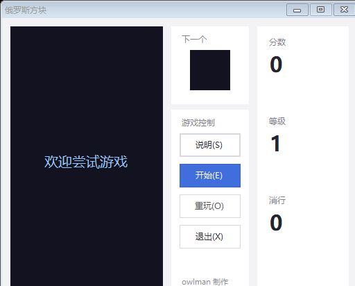
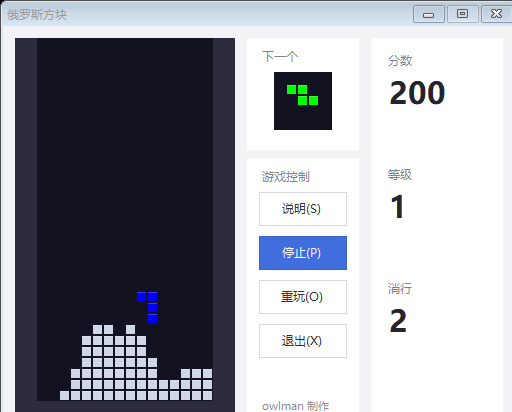
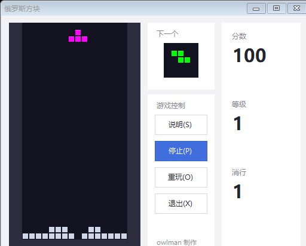

# Tetris (C# Implementation)

[简体中文](README.md) ｜ **English**

[](https://github.com/owlman/Tetris/actions/workflows/ci.yml)
[](LICENSE)
[](https://dotnet.microsoft.com/download/dotnet-framework)

> Author: owlman (Zhejiang University, 2006) · Stack: C# + Windows Forms (drawn entirely at runtime with GDI, no bitmap assets)

A Tetris clone written in C# + WinForms. The board, the falling pieces and the next-piece preview are **all drawn at runtime with GDI** — there are no pre-rendered bitmap assets. In 2026-11 a long-standing screen flicker during keyboard input was tracked down and fixed.

---

## Screenshots

All three images are produced automatically by `tests/capture.sh` driving the **real program**: it reflectively invokes `MainForm.buttonstart.PerformClick()` to start a game, then advances frame by frame on the game clock and captures the window with `DrawToBitmap`.

| Start | In play (staircase formed) | First score |
| --- | --- | --- |
|  |  |  |

The capture probe carries a simple placement evaluator (it enumerates 4 rotations × every legal column, simulates each landing with `GameBoard.CanPlace`, and scores candidates by "aggregate height / lines cleared / holes / surface bumpiness"). So the staircase in the middle image was stacked by the program itself, and the 100 points on the right were earned by clearing a line — none of it is staged.

---

## How to Play

| Key | Action |
| --- | --- |
| `↑` | Rotate the current piece |
| `←` / `→` | Move left / right |
| `↓` | Soft drop (moves down 2 cells) |

Window buttons: Start / Stop, Restart, Help, Exit (labels are in Chinese: `开始` / `停止` / `重玩` / `说明` / `退出`). The game ends when the stack reaches the top.

**Line clearing**: when every cell between the two walls of a row is occupied, that row is cleared and everything above it shifts down.

**Scoring and levels**:

| Lines cleared at once | Points (× current level) |
| --- | --- |
| 1 | 100 |
| 2 | 300 |
| 3 | 500 |
| 4 | 800 |

- Every 10 cleared lines raises the level; higher levels drop pieces faster (1000 ms at level 1, −90 ms per level, floor 120 ms).
- Before a line disappears it is highlighted for about 0.13 s, so you can see which row is going away.
- Score / level / total lines are displayed live on the right-hand side.

---

## Quick Start

### Run the pre-built binary

A compiled executable is tracked in the repository:

```Bash
owlgame/bin/Debug/owlgame.exe
```

Double-click it (Windows + .NET Framework 4.0 runtime required).

> ⚠️ This exe is a **version-controlled** artifact. After changing the source you must rebuild and overwrite it, otherwise the shipped binary drifts away from the source (see "Building from source").

### Building from source

The development machine has **no .NET Framework SDK installed**, so building with `MSBuild.exe` fails with:

```Bash
error MSB3091: resgen.exe not found ... .NET Framework SDK is not installed
```

(the exact wording depends on the localization of your SDK). We therefore call the compiler that ships with .NET Framework 4.0 directly:

```bash
# 1) Copy the sources to an ASCII-only path (csc cannot handle non-ASCII paths)
cd /c/t_build
cp "<project path>/owlgame/"*.cs .
cp "<project path>/owlgame/Properties/"*.cs Properties/
cp "<project path>/owlgame/"*.resx .
cp "<project path>/owlgame/Properties/Resources.resx" Properties/

# 2) Compile (note /main, the three /resource entries, and the icon)
MSYS_NO_PATHCONV=1 /c/Windows/Microsoft.NET/Framework64/v4.0.30319/csc.exe \
  /nologo /target:winexe /main:owlgame.Program \
  /out:owlgame.exe /debug /define:TRACE,DEBUG \
  /win32icon:"Core IP theme Icon 01.ico" \
  /resource:MainForm.resx,owlgame.MainForm.resources \
  /resource:gamehelp.resx,owlgame.gamehelp.resources \
  /resource:Properties/Resources.resx,owlgame.Properties.Resources.resources \
  *.cs

# 3) Write the tracked artifacts back
cp owlgame.exe "<project path>/owlgame/bin/Debug/owlgame.exe"
cp owlgame.pdb "<project path>/owlgame/bin/Debug/owlgame.pdb"
```

Key points:

- `MSYS_NO_PATHCONV=1` stops Git Bash from mangling `/out:` and `/resource:` as paths.
- `/main:owlgame.Program` is mandatory: any leftover probe file with its own `Main` otherwise triggers `CS0017: Program has more than one entry point`.
- All three `.resx` files must be embedded under their **assembly-qualified names**, otherwise you get `MissingManifestResourceException` at runtime.
- `csc` v4.0.30319 is a **C# 5** compiler: no local functions, no `?.`, no `$"..."` interpolation.

---

## Directory Structure

```Bash
Tetris/
├── owlgame/                    # The single project directory (project name MuscoviteBlock, assembly name owlgame)
│   ├── MuscoviteBlock.csproj   # Old-style VS2005 csproj (Format 12.00, not SDK-style)
│   ├── Program.cs              # Entry point: EnableVisualStyles + Run(new MainForm())
│   ├── MainForm.cs             # Main window logic (the only paint dispatcher)
│   ├── MainForm.Designer.cs    # Main window layout (designer-generated)
│   ├── GameBoard.cs            # Pure logic: board + move/rotate/merge/clear/game-over (no WinForms reference)
│   ├── GameController.cs       # Drawing: pixel geometry + GDI resources + dirty-rect repaint
│   ├── Block.cs                # Piece definitions: 7 shapes as 5×5 matrices + fixed per-shape colours
│   ├── gamehelp.cs(+Designer)  # The "Help" window
│   ├── *.resx / Properties/    # Resources and assembly info
│   └── bin/Debug/              # Tracked: owlgame.exe / owlgame.pdb
├── tests/                      # Tests and probes
│   ├── framework/              # Minimal in-house test framework (reflection-discovered [Test], UI category, exit code = failure count)
│   ├── TetrisTests/            # Unit tests (board / scoring / blocks / UI)
│   ├── run.sh                  # Five-stage pipeline: stage dirs → build → unit tests → pixel probes → summary
│   ├── capture.sh              # Generates the README screenshots (drives the real program through a game)
│   └── tools/                  # Pixel probes / regression probe / capture probe
├── .github/workflows/ci.yml    # GitHub Actions (windows-latest, runs run.sh --skip-ui)
├── img/                        # README screenshots (generated by tests/capture.sh)
├── AGENTS.md                   # Project guide for AI agents (build / encoding / verification)
├── README.md                   # Chinese README
├── README.en.md                # This file
└── owlgame.sln                 # Solution (upgraded to Format 12.00)
```

---

## Architecture

Four classes, with logic and rendering separated:

```bash
MainForm (UI + events)
   │  holds a controller reference; controller == null means "no game in progress"
   ├─ gamewiew_Paint(e)   ──► controller.Draw(e)               draws the board (Panel custom paint)
   ├─ proimg_Paint(e)     ──► controller.DrawPreview(proimg,e)  draws the next-piece preview (PictureBox custom paint)
   └─ gamewiew_PreviewKeyDown ─► controller.Rotate() / Move() / Down()

GameController (rendering layer)
   ├─ board : GameBoard       all rules delegated to it
   ├─ cellWidth / cellHeight  derived from the view size
   └─ Draw() / DrawPreview()  the two GDI entry points

GameBoard (pure logic layer, no WinForms reference)
   ├─ cells : List<int[]>     Empty=0 / Settled=1 / Wall=2
   ├─ Current / Next : Block  current piece / next piece
   └─ Move / MoveDown / Rotate / Merge / ClearLines / Advance / IsGameOver

Block (data)
   └─ Matrix[5,5] / Column / Row / BlockColor
```

`GameBoard` does not depend on WinForms, so the rules can be asserted directly with `new GameBoard(35)` without a message loop — that is what makes `tests/Round1Regression.cs` able to test line clearing and boundaries directly.

Key state conventions:

- **`controller == null` is the "no game started" sentinel**; every paint branch checks it to decide whether to draw.
- `gaizi` is a `Dock=Fill` Panel overlaid on the board; it is `Hide()`n while playing and `Show()`n at the end to display "Welcome, try the game" / "You failed…".
- `gamewiew` is a `Panel` (double buffering off by default), `proimg` is a `PictureBox` (double buffering on by default).

---

## Testing

A minimal in-house framework (zero dependencies, C# 5 compatible), **two entry points with different coverage**:

| Entry point | Command | Actual coverage |
| --- | --- | --- |
| CI | `bash tests/run.sh --skip-ui` | 62 logic cases + 2 pixel probes |
| Full local run | `bash tests/run.sh` | 76 cases (incl. 14 UI cases) + 2 pixel probes |

The CI `windows-latest` runner is **session 0** and has no interactive desktop, so the 14 cases that need `Form.Show()` and a message loop are skipped wholesale (via `[Category("UI")]` on `tests/TetrisTests/UiTests.cs`). The pixel probes run on both entry points — they go through `DrawToBitmap` onto an in-memory canvas and need no desktop.

**A green CI only proves "logic is correct + pixels have not regressed" — it proves nothing about behaviour that needs a human pressing buttons.** After touching the event paths (start / stop / restart / animation interruption) you must run the full suite locally. The per-case meaning of the 14 skipped tests is documented in [`tests/README.md`](tests/README.md).

---

## Known Quirks and Deliberate Designs

| Observation | Reality |
| --- | --- |
| The board is 20 columns × 35 rows | Columns are fixed at 20; **rows are derived as `v.Height / v.Width * rowNo`** (220×388 view → `20*388/220` = 35 rows, cells 11×11) |
| `block.size = 5` but there are only 7 shapes | Each shape occupies only a small 2×4 / 3×2 region of a 5×5 matrix; the rest is zero |
| The preview box does not look centred | `drawwait` positions it with `box.Width/4 + j*bw` — a hard-coded approximation |
| ~~No score, no level, no line-clear animation~~ | **Implemented** (round 5): classic scoring table + level up every 10 lines + line-clear highlight |
| ~~Logic coupled to rendering, untestable~~ | **Fixed**: split into `GameBoard` (pure logic) and `GameController` (rendering) |
| ~~New GDI objects every frame + full-board repaint~~ | **Fixed**: pens/brushes promoted to reusable fields, repaint narrowed to the union of the piece's old and new bounds |
| ~~Start button greyed out after game over~~ | **Fixed**: the button is re-enabled and its caption reset, so one click starts a new game |
| `gamecontroller.cs` has `using System.Windows.Forms` | It needs `Panel` / `PictureBox` / `PaintEventArgs` |

---

## License

[MIT License](LICENSE) © 2006-2026 owlman

Free to use, modify and redistribute, including commercially, as long as the copyright notice and a copy of the license are retained.
