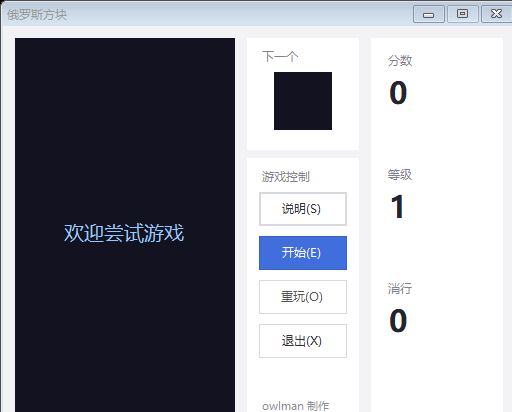
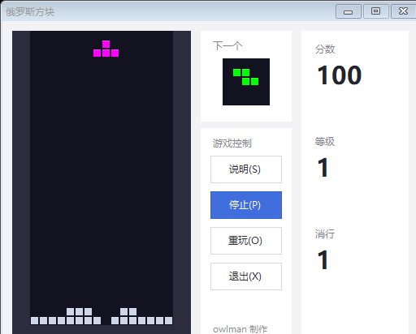
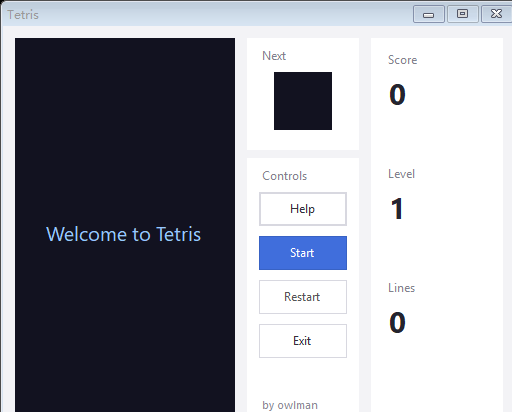
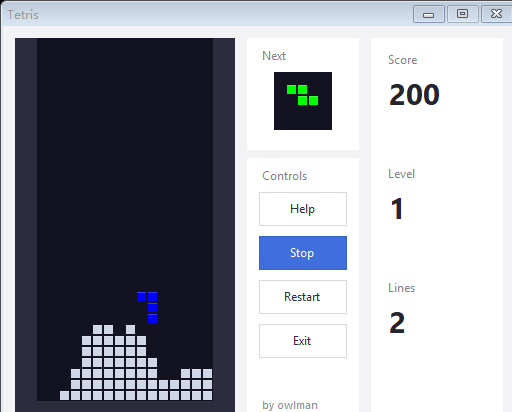

# 俄罗斯方块（C# 实现）

**简体中文** ｜ [English](README.en.md)

[](https://github.com/owlman/Tetris/actions/workflows/ci.yml)
[](LICENSE)
[](https://dotnet.microsoft.com/download/dotnet-framework)

> 作者：owlman（浙江大学，2006 年）　技术栈：C# + Windows Forms（纯 GDI 运行时绘制，不使用位图资源）

一个用 C# + WinForms 实现的俄罗斯方块小游戏。棋盘、方块、预览框**全部由 GDI 在运行时绘制**，没有预置的位图素材；2026-11 定位并修复了按键时棋盘闪烁的老毛病。

---

## 界面

三张图都由 `tests/capture.sh` 驱动**真实程序**自动跑出来：反射调用 `MainForm.buttonstart.PerformClick()` 开局，再按游戏时钟逐帧推进，用 `DrawToBitmap` 截屏。

| 开局 | 游戏中（已堆起阶梯） | 首次得分 |
| --- | --- | --- |
|  |  |  |

截图探针带一个简单的落点评估器（枚举 4 个旋转 × 全部合法列，用 `GameBoard.CanPlace` 模拟落点，按「聚合高度 / 消行数 / 空洞 / 表面崎岖度」打分选最优），所以中间那张阶梯是程序自己堆出来的、右边那张 100 分是它自己消掉一行得来的，不是摆拍。

---

## 界面语言

界面文案中英双语，默认跟随系统语言（中文系统显示中文，其余显示英文）。两种切换方式：

| 方式 | 示例 |
| --- | --- |
| 命令行参数 | `owlgame.exe --lang=en` |
| 环境变量 | `set OWLGAME_LANG=en`（PowerShell：`$env:OWLGAME_LANG="en"`）后再启动 |

语言在创建第一个窗口前解析一次，运行期间不切换 —— 所有标签都是在构造函数里从 `owlgame/Strings.cs` 取值，做成运行时可切换需要遍历控件树重排布局，本项目没有这个需求。字体也随语言走：中文用微软雅黑，英文用 Segoe UI（拉丁字形明显更好）；帮助窗体的键帽、按钮、卡片配色两套语言完全一致，由 `UiTests.HelpWindowMatchesTheModernStyle` 锁定。

英文界面截图在 `img/en/`，由 `bash tests/capture.sh en` 生成（落点评估器与中文图同一套逻辑）：

| Start | In play | First score |
| --- | --- | --- |
|  |  |  |

---

## 玩法

| 按键 | 功能 |
| --- | --- |
| `↑` | 旋转当前方块 |
| `←` / `→` | 左右移动 |
| `↓` | 加速下落（一次下移 2 格） |

界面按钮：`开始` / `停止`、`重玩`、`说明`、`退出`。方块堆到顶部即游戏结束。

**消行规则**：一行中两侧墙之间的所有格子都被方块占满时，该行被消除，上方整体下移。

**计分与等级**：

| 一次消除 | 得分（× 当前等级） |
| --- | --- |
| 1 行 | 100 |
| 2 行 | 300 |
| 3 行 | 500 |
| 4 行 | 800 |

- 每累计消除 10 行升一级；等级越高方块下落越快（1000 ms 起，每级快 90 ms，最快 120 ms）。
- 消行前会先高亮那一行约 0.13 秒再消失，方便看清是哪一行被消掉。
- 界面右侧实时显示分数 / 等级 / 消行总数。

---

## 快速开始

### 直接运行

仓库中跟踪了三份编译好的可执行文件，双击任意一份即可（Windows + .NET Framework 4.0 运行库）：

| 文件 | 界面语言 |
| --- | --- |
| `owlgame/bin/Debug/owlgame.exe` | 跟随操作系统（中文系统显示中文，其余显示英文） |
| `owlgame/bin/Debug/owlgame-zh.exe` | 恒为中文 |
| `owlgame/bin/Debug/owlgame-en.exe` | 恒为英文 |

三份大小完全相同（217 088 字节），差异只在编译期常量，详见「构建三个语言变体」。

> ⚠️ 该 exe 是**被版本控制跟踪**的产物。改动源码后必须重新编译并覆盖它，否则仓库里的程序与源码不一致（见「构建」一节）。

### 从源码构建

本机**没有安装 .NET Framework SDK**，用 `MSBuild.exe` 构建会报：

```Bash
error MSB3091: resgen.exe 未能找到 ... 未安装 .NET Framework SDK
```

因此直接调用 .NET Framework 4.0 自带的编译器 `csc.exe`：

```bash
# 1) 复制源码到纯 ASCII 路径（csc 不支持含中文的路径）
cd /c/t_build
cp "<项目路径>/owlgame/"*.cs .
cp "<项目路径>/owlgame/Properties/"*.cs Properties/
cp "<项目路径>/owlgame/"*.resx .
cp "<项目路径>/owlgame/Properties/Resources.resx" Properties/

# 2) 编译（注意 /main、三个 /resource、图标）
MSYS_NO_PATHCONV=1 /c/Windows/Microsoft.NET/Framework64/v4.0.30319/csc.exe \
  /nologo /target:winexe /main:owlgame.Program \
  /out:owlgame.exe /debug /define:TRACE,DEBUG \
  /win32icon:"Core IP theme Icon 01.ico" \
  /resource:MainForm.resx,owlgame.MainForm.resources \
  /resource:gamehelp.resx,owlgame.gamehelp.resources \
  /resource:Properties/Resources.resx,owlgame.Properties.Resources.resources \
  *.cs

# 3) 回写被跟踪的产物
cp owlgame.exe "<项目路径>/owlgame/bin/Debug/owlgame.exe"
cp owlgame.pdb "<项目路径>/owlgame/bin/Debug/owlgame.pdb"
```

要点：

- `MSYS_NO_PATHCONV=1` 防止 Git Bash 把 `/out:` `/resource:` 当成路径转换掉。
- `/main:owlgame.Program` 必须给：目录里若残留带 `Main` 的探针文件会报 `CS0017: 程序集有多个入口点`。
- 三个 `.resx` 必须以**程序集限定名**嵌入，否则运行时报 `MissingManifestResourceException`。
- `csc` v4.0.30319 是 **C# 5** 编译器：不支持本地函数、`?.`、`$"..."` 插值等 C# 6+ 语法。

### 构建三个语言变体

上面那条命令只产出「跟随系统」的一版。要一次产出全部三版并回写跟踪的产物：

```bash
bash tests/build-release.sh
```

脚本在 `/c/t_rel`（纯 ASCII 路径）里连编三次，只是 `/define:` 多一个语言常量：

| 产物 | 额外的编译期常量 | 界面语言 |
| --- | --- | --- |
| `owlgame.exe` | — | 跟随操作系统 UI 文化：`zh` → 中文，其余 → 英文 |
| `owlgame-zh.exe` | `LANG_ZH` | 恒为中文，与系统语言无关 |
| `owlgame-en.exe` | `LANG_EN` | 恒为英文，与系统语言无关 |
| `owlgame.pdb` | — | 仅 `owlgame.exe` 的调试符号（两个变体不带 pdb） |

`LANG_ZH` 与 `LANG_EN` 同时定义会触发编译期错误 `LANG_ZH and LANG_EN are mutually exclusive; pick one.`，不会静默取其中一个。

**运行时优先级**（`Strings.Configure`，先命中者胜）：

```
--lang=zh|en   >   OWLGAME_LANG 环境变量   >   编译期常量 LANG_ZH/LANG_EN   >   系统 UI 文化
```

也就是说强制了语言的 exe 仍可被命令行或环境变量覆盖：

```bash
owlgame-en.exe --lang=zh                  # 英文版临时看中文
set OWLGAME_LANG=en && owlgame-zh.exe     # 中文版临时看英文（cmd；PowerShell 用 $env:OWLGAME_LANG="en"）
```

### 编译选项逐条说明

| 选项 | 为什么必须这么写 |
| --- | --- |
| `-nologo <散文件>` | `csc` 默认会把横幅打到 stdout，`-nologo` 让脚本输出干净 |
| `-target:winexe` | 生成 GUI 程序：双击不弹控制台窗口（`exe` 会弹黑框，`library` 更是错的目标） |
| `-main:owlgame.Program` | 显式指定入口。目录里若残留带 `Main` 的探针文件（`harness*.cs` / `check*.cs`），不给会报 `CS0017: 程序集有多个入口点` |
| `-out:owlgame-en.exe` | 输出文件名。Git Bash 下必须配 `MSYS_NO_PATHCONV=1`，否则 `/out:` 会被当成路径转换掉 |
| `-debug` | 生成 `.pdb`，异常堆栈带行号。**注意它不等于 `-define:DEBUG`**，两个是独立开关 |
| `-define:TRACE,DEBUG` | 定义条件编译符号。**`TRACE` 不能省**：`Trace.WriteLine` 带 `[Conditional("TRACE")]`，不定义时整个调用会被编译器**静默删除**，诊断输出等于空操作（本项目踩过这个坑） |
| `-define:...,LANG_ZH` | 本项目自定义的符号，把界面语言钉死在编译产物里（见 `owlgame/Strings.cs` 的 `ResolveBuildLanguage`） |
| `-win32icon:"Core IP theme Icon 01.ico"` | 把图标嵌进 PE 资源。不写则 exe 显示成默认白纸图标（文件名含空格，必须加引号） |
| `-resource:X.resx,owlgame.X.resources` | 嵌入 WinForms 资源。**右侧必须是「程序集限定名」**：`owlgame` 是程序集名，`MainForm.resources` 是 `MainForm.cs` 对应的资源名。写成 `MainForm.resources` 会在运行时抛 `MissingManifestResourceException` |
| `*.cs`（含 `Properties/*.cs`） | 源码一锅编译。`Properties/Resources.Designer.cs` 是强类型资源访问器，`AssemblyInfo.cs` 提供版本与版权信息 |

三个 `.resx` 缺一不可：`MainForm.resx`（主窗体布局资源）、`gamehelp.resx`（帮助窗体）、`Properties/Resources.resx`（图标等强类型资源）。

---

## 目录结构

```Bash
Tetris/
├── owlgame/                    # 唯一的项目目录（项目名 MuscoviteBlock，程序集名 owlgame）
│   ├── MuscoviteBlock.csproj   # VS2005 时代的老式 csproj（Format 12.00，非 SDK-style）
│   ├── Program.cs              # 入口：解析 --lang / OWLGAME_LANG 后 Run(new MainForm())
│   ├── Strings.cs              # 界面文案表（中英双语）+ 语言解析 + 随语言切换的字体
│   ├── MainForm.cs             # 主窗体逻辑（自绘派发的唯一入口）
│   ├── MainForm.Designer.cs    # 主窗体布局（设计器生成）
│   ├── GameBoard.cs            # 纯逻辑：棋盘 + 移动/旋转/落子/消行/失败判定（不引用 WinForms）
│   ├── GameController.cs       # 绘制：像素几何 + GDI 资源 + 脏矩形重绘
│   ├── Block.cs                # 方块定义：7 种形状的 5×5 矩阵 + 形状固定配色
│   ├── gamehelp.cs(+Designer)  # 「说明」帮助窗体
│   ├── *.resx / Properties/    # 资源与程序集信息
│   └── bin/Debug/              # 已跟踪：owlgame.exe / owlgame.pdb
├── tests/                      # 测试与探针
│   ├── framework/              # 自建的极简测试框架（反射发现 [Test]、UI 分类、exit code = 失败数）
│   ├── TetrisTests/            # 单元测试用例（棋盘 / 计分 / 方块 / UI）
│   ├── run.sh                  # 五步流水线：备目录 → 编译 → 单测 → 像素探针 → 汇总
│   ├── capture.sh              # 生成 README 截图（`capture.sh` 中文 / `capture.sh en` 英文）
│   └── tools/                  # 像素探针 / 回归探针 / 截图探针
├── .github/workflows/ci.yml    # GitHub Actions（windows-latest，跑 run.sh --skip-ui）
├── img/                        # README 截图（中文界面，由 tests/capture.sh 生成）
├── img/en/                     # 英文界面截图（由 tests/capture.sh en 生成）
├── AGENTS.md                   # 面向 AI Agent 的项目工作指引（构建 / 编码 / 验证）
├── README.md                   # 本文件（简体中文）
├── README.en.md                # English README
└── owlgame.sln                 # 解决方案（已升级到 Format 12.00）
```

---

## 源码架构

四个类，逻辑与绘制分离：

```bash
MainForm (UI + 事件)
   │  持 controller 引用；controller == null 表示「未开局」
   ├─ gamewiew_Paint(e)   ──► controller.Draw(e)              画主棋盘（Panel 自绘）
   ├─ proimg_Paint(e)     ──► controller.DrawPreview(proimg,e) 画「下一个」预览（PictureBox 自绘）
   └─ gamewiew_PreviewKeyDown ─► controller.Rotate() / Move() / Down()

GameController (绘制层)
   ├─ board : GameBoard       规则全部委托
   ├─ cellWidth / cellHeight  由 view 宽高算出
   └─ Draw() / DrawPreview()  两个 GDI 绘制入口

GameBoard (纯逻辑层，不引用 WinForms)
   ├─ cells : List<int[]>     Empty=0 / Settled=1 / Wall=2
   ├─ Current / Next : Block  当前块 / 下一个块
   └─ Move / MoveDown / Rotate / Merge / ClearLines / Advance / IsGameOver

Block (数据)
   └─ Matrix[5,5] / Column / Row / BlockColor
```

`GameBoard` 不依赖 WinForms，规则可以直接 `new GameBoard(35)` 断言，不需要消息循环 —— 这是 `tests/Round1Regression.cs` 能直接测消行与边界的前提。

关键状态约定：

- **`controller == null` 是「未开局」哨兵**，所有 Paint 分支都靠它判断要不要画。
- `gaizi` 是覆盖在棋盘上的 `Dock=Fill` Panel，开局时 `Hide()`、结束时 `Show()` 显示「欢迎尝试游戏」/「你失败了…」。
- `gamewiew` 是 `Panel`（默认不开双缓冲），`proimg` 是 `PictureBox`（默认开双缓冲）。

---

## 测试

自建极简框架（零依赖，适配 C# 5），**两条入口覆盖范围不同**：

| 入口 | 命令 | 实际覆盖 |
| --- | --- | --- |
| CI | `bash tests/run.sh --skip-ui` | 72 个逻辑用例 + 2 个像素探针 |
| 本地完整 | `bash tests/run.sh` | 86 个用例（含 14 个 UI 用例）+ 2 个像素探针 |

CI 的 `windows-latest` runner 是 **session 0**，没有交互式桌面，所以涉及 `Form.Show()` 与消息循环的 14 条用例被整类跳过（靠 `tests/TetrisTests/UiTests.cs` 上的 `[Category("UI")]`）。像素探针两条入口都跑 —— 它们走 `DrawToBitmap` + 内存画布，不依赖桌面。

**CI 绿只证明「逻辑正确 + 像素不退化」，证明不了任何需要真人点按钮的行为**。改动事件线（开始 / 停止 / 重玩 / 动画中断）之后必须在本地跑一次完整套。被跳过的 14 条用例逐条对应的界面行为，见 [`tests/README.md`](tests/README.md)。

---

## 已知问题与设计上的怪癖

| 现象 | 真相 |
| --- | --- |
| 棋盘是 20 列 × 35 行 | 列数固定 20，**行数由 `v.Height / v.Width * rowNo` 算出**（控件 220×388 → `20*388/220` = 35 行，格子 11×11） |
| `block.size = 5` 但只有 7 种形状 | 5×5 矩阵里实际只占 2×4 / 3×2 等一小块，其余是 0 |
| 预览框位置看起来没居中 | `drawwait` 用 `box.Width/4 + j*bw` 定位，是硬编码的近似居中 |
| ~~没有分数、没有等级、没有消行动画~~ | **已实现**（第 5 轮）：经典计分表 + 每 10 行升级 + 消行高亮 |
| ~~逻辑与绘制耦合、无法单测~~ | **已修复**：拆出 `GameBoard`（纯逻辑）与 `GameController`（绘制） |
| ~~每帧新建 GDI 对象 + 全棋盘重绘~~ | **已修复**：Pen/Brush 提为字段复用，重绘收窄到块移动的并集区域 |
| ~~游戏结束后「开始」按钮变灰~~ | **已修复**：失败后按钮恢复可用且文案复位，一次点击即可开新局 |
| `gamecontroller.cs` 里有 `using System.Windows.Forms` | 为了用 `Panel` / `PictureBox` / `PaintEventArgs` |

---

## 许可证

[MIT License](LICENSE) © 2006-2026 owlman

可以自由使用、修改、分发，包括商业用途，只需保留版权声明与许可证副本。
